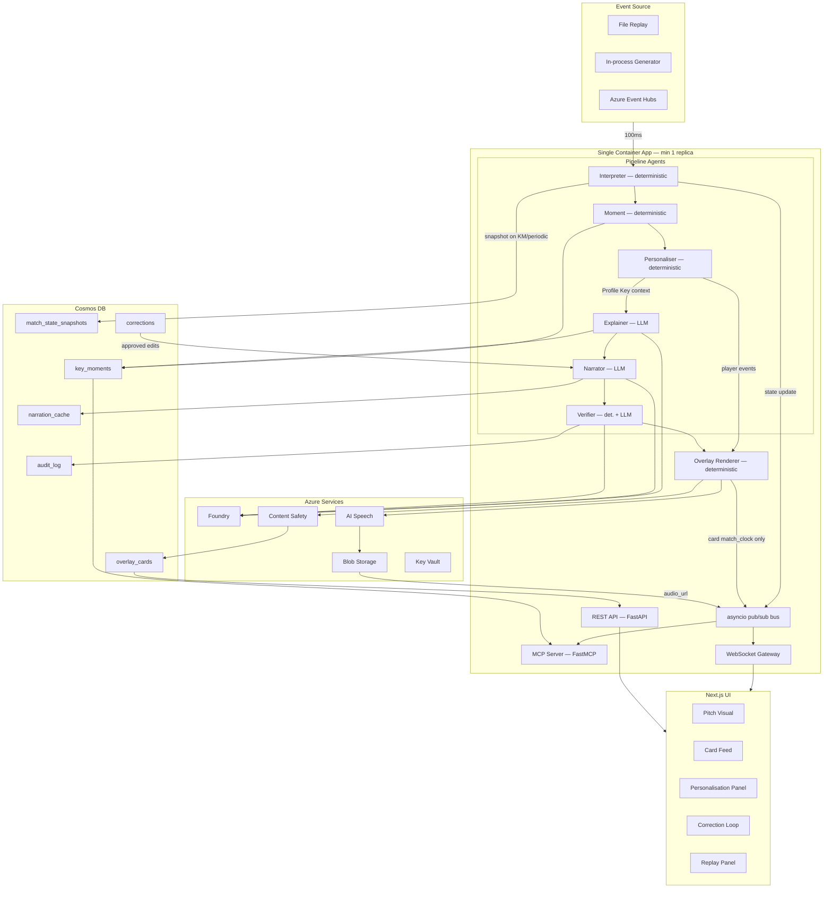

# Design Document — Msimulizi

## Overview

Msimulizi is a real-time match intelligence platform built on Azure. A synthetic event stream passes through a six-agent pipeline — three deterministic and three LLM-backed — producing timed JSON Overlay Cards and audio commentary in Swahili, English, and French. A Next.js viewer UI consumes these cards in real time.

The architecture is organised into five horizontal layers:

1. **Event source** — swappable adapter (file replay, in-process generator, Azure Event Hubs)
2. **Intelligence pipeline** — Interpreter → Moment → Personaliser → Explainer → Narrator → Verifier agents
3. **Rendering** — deterministic Overlay Renderer writing cards to Cosmos DB; audio via Azure AI Speech to Blob Storage
4. **Exposure** — REST API (cards), MCP Server (state/moment queries), asyncio pub/sub bus + WebSocket gateway (live push)
5. **Viewer UI** — Next.js frontend

### Single-process deployment

The pipeline worker, REST API, WebSocket gateway, and MCP server all run as one FastAPI application (FastMCP mounted as a sub-router) in a single Container Apps revision pinned to **minimum 1 replica** with scale-to-zero disabled. This keeps in-memory state (per-session MatchState, per-session scheduler queue, pub/sub subscriptions) alive without a Redis dependency.

If horizontal scaling becomes necessary later, the in-process asyncio pub/sub bus can be replaced with Azure Cache for Redis with no changes to agent logic.

---

## Architecture



### Happy-path timing (p50 ≤ 5 s to card, p50 ≤ 8 s to audio)

```
Event received
  Adapter → Interpreter        ≤100 ms
  Interpreter (state update)   ≤200 ms
  Moment (detect + rank)       ≤300 ms   → write KeyMoment to Cosmos
  Personaliser (rank + route)   ≤50 ms   (deterministic)
  Explainer (build explanation) ≤1 s     → update KeyMoment in Cosmos
  Narrator (per Profile Key)    ≤1.5 s   (response held in memory)
  Verifier pre-check            ≤200 ms
  Verifier LLM                  ≤1 s     → write to audit_log
  Content Safety                ≤300 ms
  Cache write (on pass)                  → write to narration_cache
  Renderer (write + pub/sub)    ≤100 ms  → write to overlay_cards
  WebSocket push                         → card delivered to UI
  TTS (parallel)                ≤3 s after card → audio_url update pushed
```

### Replay clock and lookahead

Each session maintains a `SessionClock` object:
```python
@dataclass
class SessionClock:
    anchor_wall: float      # wall-clock time of last speed change or restart
    anchor_match: float     # match time (seconds) at that moment
    speed: float            # current multiplier (0.1–4.0)

    def match_time(self) -> float:
        return self.anchor_match + (time.monotonic() - self.anchor_wall) * self.speed

    def wall_time_for(self, match_seconds: float) -> float:
        return self.anchor_wall + (match_seconds - self.anchor_match) / self.speed
```

The pipeline runs a **fixed 10-second match-time lookahead** ahead of the viewer's clock. The adapter emits events for `match_time + 10s`; cards are ready before their `display_from`. `display_from = clock.wall_time_for(event.match_seconds)`. When the viewer changes speed or restarts, `SessionClock` is updated and all future `display_from` computations use the new anchor — no epoch arithmetic needed.

### Retry / fallback path (p95 ≤ 10 s)

```
Verifier fail → Narrator retry (≤1.5 s) → Verifier re-check (≤1.4 s)
  Still fail → deterministic Fallback Line (immediate)
Any LLM call > 3 s → asyncio timeout → Fallback Line + log timeout
```

---

## Components and Interfaces

### Event ID scheme

`event_id = f"{match_id}-{sequence_number:06d}"` where `sequence_number` is a monotonic counter starting at 1, reset per match. This is deterministic for a given seed and storyline, making Claims Lists and audit entries stable across runs.

### Profile Key format

`profile_key = f"{match_id}.{language}.{mode}.{club_perspective}"` (dots, no pipes). Safe for filenames, URL path segments, and Cosmos DB partition keys.

### Match Generator

- Language: Python 3.12 — `generator/generate.py`

```python
def make_match_id(storyline: str, seed: int) -> str:
    return sha256(f"{storyline}:{seed}".encode()).hexdigest()[:16]

def generate_match(storyline: str, seed: int) -> Iterator[Event]:
    rng = random.Random(seed)
    ...  # all stochastic draws use rng, never random module
```

- Storyline configs: `generator/storylines/*.yaml`
- Calibration bands per storyline: `generator/validation_config.yaml`
- Validation script: `generator/validate.py` (exits non-zero on band drift)
- All shot events call `shared.xg.compute_xg(distance, angle, is_header, is_penalty)`

### Shared xG Function

```python
# shared/xg.py
def compute_xg(distance: float, angle: float, is_header: bool, is_penalty: bool) -> float:
    """Logistic regression. Coefficients in shared/xg_coefficients.json.
    Trained during hackathon window; see DATA_PROVENANCE.md.
    """
```

Imported by both the generator and the Interpreter Agent.

### Numeric Evidence Format

Each entry in `numeric_evidence` carries:

```python
@dataclass
class NumericEvidence:
    metric: str          # e.g. "field_tilt_home"
    raw_value: float     # e.g. 0.62
    display_value: str   # e.g. "62%"  — canonical ASCII, see below
    unit: str            # e.g. "percent"
```

**Canonical number format (all languages use ASCII):**
- Percentages: `"62%"` (no space before %)
- Decimals: `"0.46"` (decimal point, not comma — French narration uses the same convention)
- Scores: `"2-1"` (hyphen, no spaces)
- Stoppage time: `"90+2"` (plus sign, no spaces)
- Integers: `"3"` (no separators)

The Explainer's LLM prompt instructs the model to copy `display_value` verbatim. The Verifier's Text Consistency Check scans for the canonical patterns using this regex (covers all five formats):

```
NUMBER_RE = r"\d+\+\d+|\d+-\d+|\d+\.\d+|\d+%|\d+"
```

Metric claims in the Claims List carry `display_value` as their value.

**Explainer number check (requirement 5.4 — correct direction):** After the LLM writes the `reason`, scan the reason with `NUMBER_RE`. Every matched token must appear as a `display_value` in `numeric_evidence`. If a token is not in the evidence, the reason contains a hallucinated number → regenerate once → template fallback.

### Event Source Adapter

```python
# adapter/base.py
class EventSourceAdapter(Protocol):
    async def events(self, session_id: str, speed: float = 1.0) -> AsyncIterator[Event]: ...
```

Selected by `EVENT_SOURCE` env var (`file` | `inprocess` | `eventhubs`). Each session gets its own adapter instance with its own replay clock.

### Interpreter Agent

- Deterministic; maintains one `MatchState` per **session** (not per match_id) in memory
- Writes Cosmos DB snapshots (partitioned by `match_id`) at Key Moments, every 2 match minutes, half time, full time, and on reconnect
- Publishes state to asyncio pub/sub bus after every event (MCP Server subscribes here)

**Momentum Score per team:**
```
window = events with event.minute >= current_minute - 10
raw_team    = Σ(shot×2 + xg×10 + pressure×1 + possession_change×0.5) for team's events in window
raw_opp     = same for opponent's events in window
score_team  = clamp(50 + raw_team - raw_opp, 0, 100)
score_opp   = clamp(50 + raw_opp - raw_team, 0, 100)
diff_now    = score_team - score_opp
diff_10min  = same value computed at (current_minute - 10)
swing       = |diff_now - diff_10min| >= 15  →  momentum_swing trigger
```

### Moment Agent

- Deterministic; consumes (MatchState, Event)
- Merges all trigger tags for one Event into a single `KeyMoment`
- Multi-tag Priority Rank: take the best (lowest integer) rank among all tags; raise by 1 if `late_game` tag present (floor 1)
- Momentum swing cooldown: per-session `{match_id: last_swing_minute}`; suppresses if < 10 match minutes since last swing
- `moment_id = f"{match_id}-km-{km_sequence:04d}"` — deterministic, monotonic per session

### Personaliser Agent

- Deterministic; no LLM
- Receives both `KeyMoment` records **and** raw `Event` stream (needed for Spotlight Cards on non-KM events)
- **Derived spotlight flags (no new EventType needed):**
  - `assist_derived`: the scoring team's last successful pass (`outcome="success"`) by a different player within 5 match seconds before the goal event, detected by event sequence scan
  - `tackle_won_derived`: `event_type=tackle` with `outcome="success"`
- For Key Moments: maps `favourite_club` → `ClubPerspective`, derives Profile Keys, checks narration cache
- For raw Events: checks if `favourite_player` is involved in a notable event (goal, shot, assist_derived, tackle_won_derived, interception, card); if so, flags the Renderer to emit a Spotlight Card (subject to 3-minute spacing rule)
- Returns a list of `NarrationRequest` objects (cache misses only) — a single-flight lock per `(profile_key, moment_id)` prevents duplicate concurrent LLM calls for the same key
- Cached Narrator Responses go directly to the Renderer; no re-verification needed (they were verified and Content Safety-checked when first generated); Fallback Lines are never cached

### Explainer Agent (LLM-backed)

Receives `(KeyMoment, MatchState)`. If a `StructuredExplanation` already exists for `(match_id, trigger_event_id)` in Cosmos DB, it is returned immediately without an LLM call.

Steps for cache miss:
1. Select theme deterministically from `explainer/theme_rules.yaml`
2. Pick ≤3 `NumericEvidence` entries
3. Collect `evidence_event_ids` (trigger + ≤2 supporting)
4. LLM call: write `reason` using only supplied evidence
5. Post-LLM: scan `reason` with `NUMBER_RE`; every token must be a `display_value` in evidence; regenerate once if not; template if fails again
6. Write `StructuredExplanation` to Cosmos DB

Timeout: 1 s → template reason, `partially_grounded=True`.

### Narrator Agent (LLM-backed)

Invoked once per `NarrationRequest` (cache miss per Profile Key per Key Moment).

Prompt:
- System: language persona, mode constraint, length limits (`≤60 / ≤140 chars`), Claims List schema, instruction to copy `display_value` verbatim, canonical number format rules
- Few-shot: 4–6 natively authored examples per language
- User: `StructuredExplanation` + event fields + `ClubPerspective` + mode

Response schema (Foundry structured output):
```json
{
  "headline": "string",
  "body": "string",
  "claims_list": [{"claim_type": "player|minute|score|metric|event_id", "value": "string"}],
  "gloss_en": {"headline": "string", "body": "string"}
}
```

`gloss_en` required for `language == "sw"`. The Narrator Agent does NOT write to `narration_cache` — the cache write happens only after the Verifier passes and Content Safety clears (see Verifier Agent section).

### Verifier Agent (LLM-backed + deterministic pre-check)

**Pre-check (no LLM):**
1. Claims List validation: every claim against event record + MatchState + `numeric_evidence` (`display_value` for metric claims)
2. Text Consistency Check: scan `headline + body + gloss_en` with `NUMBER_RE` and player name list → every token needs a matching claim; every claim value must appear in the text
3. Length check: `len(headline) ≤ 60` and `len(body) ≤ 140`

Pre-check fail → immediate fail verdict, no LLM.

**LLM check (pre-check pass):**
- Confirms narration is consistent with `reason`; `gloss_en` faithfully translates Swahili text
- Returns `{"verdict": "pass"|"fail", "rejection_reason": "string|null"}`

**Cache write (pass + Content Safety clear only):**
The `NarratorResponse` is written to `narration_cache` only after the Verifier emits a pass verdict **and** Content Safety clears. The cache entry stores a reference to the Audit Log entry (`log_id`). Cache hits served by the Personaliser need no re-verification. Fallback Lines are never written to the cache.

All responses (pass and fail) stored in `audit_log` (create-only RBAC role).

### Microsoft Foundry — model deployments and evaluation

Each LLM-backed agent targets a named Foundry deployment. Deployment names are in `config/foundry_models.yaml`:

| Agent | Model deployment | Notes |
|---|---|---|
| Explainer | `gpt-4o-mini` | Structured output; low token count (reason = 1 sentence) |
| Narrator (sw) | `gpt-4o` | Best multilingual; Swahili quality validated early |
| Narrator (en/fr) | `gpt-4o-mini` | Sufficient for English/French |
| Verifier LLM check | `gpt-4o-mini` | Short grounding check |

**Model comparison harness** (`scripts/compare_swahili_models.py`): generates 10 fixed Key Moments with seed 42, calls each candidate model deployment, writes outputs to `evals/swahili_comparison.json` for native-speaker review. Run this before committing to a Swahili model deployment.

**Foundry evaluation dataset** (`evals/groundedness_eval.jsonl`): 50 Key Moments with expected Claims Lists; run via the `azure-ai-evaluation` Python SDK (`AIEvaluator`) pointing at the Narrator deployment. Results written to `evals/results/` and reported in the README.

### Infrastructure as code

All Azure resources defined in `infra/` using Azure Developer CLI (`azd`) Bicep templates:
- `infra/main.bicep` — Container Apps environment, Cosmos DB account, Key Vault, Blob Storage, role assignments
- `infra/main.parameters.json` — environment-specific parameters (resource group, region, container image tags)
- `azure.yaml` — `azd` service definitions for `backend` and `frontend`

Judges can reproduce the full deployment with `azd up`.

**Model retirement risk:** Verify that `gpt-4o` and `gpt-4o-mini` deployment retirement dates in your Foundry region fall after 10 November 2026. If a model retires during judging the live path dies. Check the Azure OpenAI model lifecycle page and pin explicit API versions in `foundry_models.yaml`.

### Overlay Renderer

Deterministic Python.

**card_id scheme (profile-keyed, no collisions):**
- LLM cards: `sha256(f"{profile_key}:{moment_id}").hexdigest()[:16]`
- Stat cards: `sha256(f"stat:{profile_key}:{period}:{minute}").hexdigest()[:16]` (includes language + mode)
- Spotlight cards: `sha256(f"spot:{profile_key}:{player_name}:{event_id}").hexdigest()[:16]` (includes player; no session_id; TTL 24h on Cosmos document)

**display_from** is not stored in Cosmos DB. The server sends each item with `match_seconds` (the event's absolute position in the match in seconds). The client runs a `ClientClock` that tracks the current viewer-time match position, and schedules items locally using `match_seconds`. `clock_update` messages are sent on speed change, restart, or seek. This eliminates ISO timestamp skew and makes speed changes instant without resending cards.

MCP state is at pipeline time (10 s ahead of viewer time), which is expected for external tooling; document this in the README.

**`display_duration_ms` by card type:** goal 8000, key_moment 6000, stat 4000, player_spotlight 5000, recap 10000.

**Lookahead** is defined in wall-clock seconds: the adapter emits events for `match_time + (10 × speed)` wall seconds ahead of the viewer's current match time. At 4× this gives 40 match seconds, well beyond the ~4.7 s pipeline latency even at full retry. A card that arrives after its `match_seconds` is displayed immediately if Priority Rank 1, or dropped if Priority Rank 2–5 and stale by more than 2 s.

Per-session priority scheduler: pre-emption, Priority Rank 1 queuing, lower-priority dropping as per Req 8.5. The server sends `match_seconds` with each card; the client schedules display locally.

Stat Cards at match minutes 15, 30, 60, 75, half time, full time — localised templates + Content Safety, no LLM.

Spotlight Cards on Personaliser flag — localised templates + Content Safety, no LLM.

Publishes card + `match_seconds` to pub/sub bus immediately after Cosmos write. Starts TTS in parallel; publishes `{"type": "audio_update", "card_id": ..., "audio_url": ..., "match_seconds": ...}` when complete.

### MCP Server (FastMCP, mounted in the same FastAPI app)

```python
@mcp.tool()
async def get_match_state(
    match_id: str,
    session_id: str | None = None   # None = most recent across sessions
) -> MatchStateSnapshot: ...

@mcp.tool()
async def list_key_moments(
    match_id: str,
    trigger_tags: list[str] | None = None,
    min_priority: int | None = None,
    limit: int = 20
) -> list[KeyMomentSummary]: ...

@mcp.tool()
async def get_player_stats(
    match_id: str,
    player_name: str,
    session_id: str | None = None   # None = most recent; player stats live in per-session MatchState
) -> PlayerStats: ...
```

State read from in-memory pub/sub (≤1 s staleness); moments read from Cosmos DB.

### REST API

```
GET  /v1/matches/{match_id}/cards
     ?profile_key=&after_match_clock=&limit=

GET  /v1/matches/{match_id}/state?session_id=

GET  /v1/audit/{match_id}/log?limit=      (reviewer key required)

POST /v1/corrections
GET  /v1/corrections/queue                (reviewer key required)
PATCH /v1/corrections/{id}               (reviewer key required)
```

Per-IP rate limiting in FastAPI middleware. Correction edits pass Content Safety before storing.

### WebSocket Gateway

One connection per Replay Session. **Session IDs are server-issued** (UUID generated by the server on HTTP handshake) to enforce the concurrent session cap. Clients receive their `session_id` in the HTTP upgrade response header before the WebSocket opens.

- Server subscribes to pub/sub for `session_id`; sends `match_seconds` with each card
- Pushes `OverlayCard` objects (with `match_seconds`) and `audio_update` messages
- Sends `{"type": "clock_update", "match_seconds": ..., "speed": ...}` on speed change or restart
- Enforces per-IP connection limit and concurrent session cap
- **Ping/pong heartbeat** sent from server every 30 s; client must respond within 10 s — prevents Container Apps ingress from closing idle connections before the 10-minute timeout
- Idle > 10 min (no events, no pong) → `{"type": "session_timeout"}` + close

---

## Data Models

### Event

```python
@dataclass
class Event:
    event_id: str          # "{match_id}-{sequence:06d}"
    match_id: str
    period: int
    minute: int
    second: int
    team: str
    player: str
    event_type: EventType
    x_start: float
    y_start: float
    x_end: float | None
    y_end: float | None
    outcome: str | None
    xg: float | None       # shots only; computed by shared.xg.compute_xg
    is_header: bool        # shots only; passed to compute_xg
    is_penalty: bool       # shots only; passed to compute_xg
    pressure: bool
    score_home: int
    score_away: int
```

### MatchState (one instance per active session, in memory)

```python
@dataclass
class MatchState:
    match_id: str
    session_id: str
    sequence_number: int       # event sequence number (deterministic per match)
    last_event_id: str         # f"{match_id}-{sequence_number:06d}"
    minute: int
    second: int
    score_home: int
    score_away: int
    possession_home: float
    field_tilt_home: float
    field_tilt_away: float
    xg_home: float
    xg_away: float
    momentum_home: float       # 0–100
    momentum_away: float       # 0–100
    pressure_rate_home: float
    pressure_rate_away: float
    tempo: float
    player_stats: dict[str, PlayerStats]
    updated_at: datetime
```

Cosmos DB snapshots are keyed by `(match_id, sequence_number)` and upserted (not inserted). Because replays are deterministic, two sessions at the same event sequence produce identical state — the upsert is idempotent. `session_id` is stored in the snapshot for debugging but is not the partition key.

### KeyMoment

```python
@dataclass
class KeyMoment:
    moment_id: str             # "{match_id}-km-{sequence:04d}"
    match_id: str
    trigger_event_id: str
    trigger_tags: list[str]
    priority_rank: int
    minute: int
    second: int
    structured_explanation: StructuredExplanation | None
    created_at: datetime
```

### StructuredExplanation

```python
@dataclass
class StructuredExplanation:
    theme: str
    reason: str
    numeric_evidence: list[NumericEvidence]
    evidence_event_ids: list[str]
    partially_grounded: bool
```

### NarratorResponse

```python
@dataclass
class NarratorResponse:
    profile_key: str           # "match_id.lang.mode.club_perspective"
    moment_id: str
    headline: str
    body: str
    claims_list: list[Claim]
    gloss_en: GlossEn | None
    generated_at: datetime
```

### OverlayCard (Cosmos DB — no display_from stored)

```json
{
  "card_id": "string",
  "match_id": "string",
  "profile_key": "string",
  "match_clock": {"period": 1, "minute": 67, "second": 23},
  "display_duration_ms": 6000,
  "card_type": "key_moment",
  "priority": 2,
  "player_ref": "string | null",
  "team_ref": "string",
  "text": {
    "sw": {"headline": "string", "body": "string"},
    "en": {"headline": "string", "body": "string"},
    "fr": {"headline": "string", "body": "string"}
  },
  "gloss_en": {"headline": "string", "body": "string"},
  "structured_explanation": {},
  "evidence_event_ids": [],
  "stat_payload": {},
  "audio_url": "string | null",
  "synthetic_ai_generated": true,
  "from_bundle": false
}
```

`display_from` is computed by the WebSocket gateway per session and included in the WebSocket push payload but not stored.

### WebSocket push payload (adds display_from)

```json
{
  ...all OverlayCard fields...,
  "display_from": "ISO8601"
}
```

---

## Cosmos DB containers (6)

| Container | Partition key | Writer role | Reader |
|---|---|---|---|
| match_state_snapshots | /match_id | Upsert by (match_id, sequence_number) — idempotent | MCP Server, REST API |
| key_moments | /match_id | agent worker | MCP Server, REST API |
| narration_cache | /profile_key | agent worker | agent worker, REST API |
| overlay_cards | /match_id | Renderer | REST API, WebSocket |
| audit_log | /match_id | Verifier (create-only RBAC) | REST API (reviewer) |
| corrections | /match_id | REST API | REST API (reviewer + Narrator) |

---

## Error Handling

| Failure | Detection | Recovery |
|---|---|---|
| Verifier pre-check fails | Claims List / TCC / length | Fail verdict; Narrator retries with reason |
| Verifier LLM returns fail | verdict = "fail" | Narrator retries once; if fails again → Fallback Line |
| Any LLM > 3 s | asyncio timeout | Fallback Line + log |
| Explainer LLM > 1 s | asyncio timeout | Template explanation, `partially_grounded=True` |
| Explainer number scan fails twice | regex check | Template reason |
| Content Safety blocks | API response | Drop card; Fallback Line (KM) or silent drop (stat/spotlight); log |
| Azure AI Speech failure | HTTP error / timeout | Show text caption; `audio_url=null`; log |
| Cosmos write failure | Exception | Exponential backoff ×3; buffer in memory; retry every 60 s |
| Event source disconnection > 5 s | Adapter heartbeat | Log + resume from last event on reconnect |
| Model quota exceeded (429) | Azure 429 | Pre-generated Bundle (default) or Fallback Lines (other); log |
| Replay speed > 4× | Speed check | Disable live LLM; serve Cached Narration or Fallback Lines |
| Session idle > 10 min | Server timer | `session_timeout` WebSocket message; release resources |
| Narrator Response > length limit | Verifier length check | Fail with "length"; Narrator retried with explicit instruction |
| Fallback Lines | Never cached | Retry on next identical request can still succeed |

Fallback templates: `renderer/fallback_templates.yaml`. Per `(moment_type, language)`. Swahili templates include `gloss_en`. Use only `player`, `minute` (display format), `event_type`, score.

---

## Deployment

Single Container Apps revision (min 1 replica, scale-to-zero off). Backend image: Python 3.12. Frontend: Next.js 14 in a separate Container App (or Static Web Apps).

```
Azure Container Apps environment
├── backend  (FastAPI + FastMCP + Agent Framework)  min=1, scale-to-zero=off
└── frontend (Next.js)

Cosmos DB          — 6 containers; spotlight container has TTL enabled (24h default)
Azure AI Speech    — sw-KE/TZ, en-US, fr-FR voices
Azure AI Content Safety
Microsoft Foundry  — model hosting and evaluation
Azure Blob Storage — audio files + bundle manifest
Azure Key Vault    — all secrets via managed identity
Azure Monitor      — Application Insights; p50/p95 latency via custom metrics; alerts on 429s
GitHub Actions     — CI: lint → tests → validate → build → deploy
```

---

## Testing Strategy

| Layer | Coverage | Method |
|---|---|---|
| Unit | xG function | Parametrized cases against known geometries |
| Unit | Generator determinism + event_id scheme | Two identical runs; assert equal |
| Unit | Calibration validation script | Inject out-of-band statistics; assert non-zero exit |
| Unit | Interpreter: state metrics | Crafted event sequences; assert snapshots |
| Unit | Momentum Score formula | Explicit window scenarios with known values |
| Unit | Moment Agent: tag merge, Priority Rank, late_game, cooldown | Multi-trigger and cooldown scenarios |
| Unit | NumericEvidence: all five canonical formats | Percent, decimal, score, stoppage, integer |
| Unit | Explainer number check (correct direction) | Reason with hallucinated number; assert regen trigger |
| Unit | Verifier pre-check + Text Consistency Check | Wrong player, minute, score, metric, missing event_id; digit with no claim; claim absent from text |
| Unit | Failure recovery | Mock LLM; single retry; double-fail → Fallback; timeout → Fallback |
| Unit | Renderer scheduling | Overlapping cards; pre-emption; PR1 queued; low-priority drop |
| Unit | Personaliser spotlight spacing + metric-focus | 3-min window; drop/halve; PR1 never altered |
| Unit | Single-flight cache lock | Two concurrent requests for same (profile_key, moment_id); assert one LLM call |
| Integration | Full end-to-end replay (single session) | `comeback_from_two_down`, seed 42; ≥1 card of each type |
| Integration | Two sessions at different positions | Same match_id; assert independent MatchState and card scheduling |
| CI | Generator calibration | `validate.py` in CI; fail build on band drift |
| Evaluation | Groundedness | Foundry eval on 50 Key Moments; assert ≥90% |
| Manual | Swahili quality | Native-speaker rating; ≥4/5 avg over ≥30 lines |

`MockFoundryClient` returns pre-scripted JSON for all LLM calls; tests run offline and deterministically.

---

## Pre-generated Bundle

Covers all 18 Profile Keys (`comeback_from_two_down`, seed 42). Generation script: `scripts/generate_bundle.py`.

```
bundle/
  cards/<profile_key>.json    # all Overlay Cards for that Profile Key
  audit/<profile_key>.json    # Claims Lists + Verifier Verdicts
  manifest.json               # card_ids, audio object URLs, SHA-256 checksums
```

Audio stored in Azure Blob Storage (public read). `card_id` is deterministic so URLs are stable.

**Bundle loading:** At startup the backend seeds `narration_cache` from `bundle/cards/*.json`, flagging each card `from_bundle=true`. The default storyline replay then hits the cache on every card — same path as live generation, zero model cost.

UI shows a "pre-generated" label when `from_bundle=true`.

---

## Viewer UI

Next.js 14 (App Router).

Pages:
- `/` — default demo (bundle replay, personalisation, replay panel)
- `/about` — StatsBomb attribution, data provenance, AI disclosure
- `/review` — key-gated reviewer page: native-speaker rating queue, correction approval, groundedness score, p50/p95 latency charts

Components:
- `<MatchClock>` — live clock + score via WebSocket
- `<PitchVisual>` — SVG pitch; event dot at `(x_start, y_start)`
- `<CardFeed>` — overlay cards timed to `display_from` / `display_duration_ms`
- `<PersonalisationPanel>` — language, mode, club, player, metric, audio-only
- `<ReplayPanel>` — storyline selector, speed slider (0.1×–4×), restart
- `<CorrectionLoop>` — thumbs up/down; optional edit textarea; submit to review queue

Accessibility: semantic HTML, ARIA labels, visible focus outline, WCAG 2.1 AA contrast. Audio-only mode shows clock and audio player only. Swahili cards display `gloss_en` directly beneath. `synthetic_ai_generated` and `from_bundle` labels always visible.

---

## Security

- No PII; all names fictional
- Secrets: Key Vault + managed identity; nothing committed
- Content Safety on all LLM output before storage or delivery
- Audit log: create-only RBAC on Cosmos container
- WebSocket gateway: per-IP connection limit, concurrent session cap, idle timeout, server-issued session IDs
- Correction edits: Content Safety before storing
- CORS: API and WebSocket accept only the deployed UI origin
- Reviewer and MCP endpoints: `Authorization: Bearer <key>` from Key Vault
- Demo URL: public, no auth
- Cosmos spotlight_cards container: TTL enabled at container level for the 24 h document expiry to take effect
