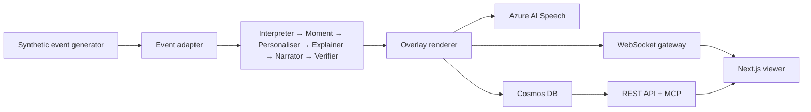

# Msimulizi — AI Match Intelligence

**Msimulizi** (Swahili for “the narrator”) turns a synthetic football event stream into live, explainable commentary cards in **Swahili, English, and French**. It is built for the Microsoft AI Tour Hackathon (*Inside the Game*) and runs as a FastAPI + WebSocket backend with a Next.js viewer.

Every match is synthetic. The clubs and players are fictional. Every Swahili card carries an English gloss; captions are the primary surface and audio is an enhancement. When the audio uses a spoken rewrite, the audio update carries the derived line and its English gloss without changing the card.

---

## What it does

- **Live match clock** that stays anchored to the authoritative event time.
- **Personalised cards** by language, mode (casual / analyst), and club perspective.
- **Analyst view** with a working heatmap, possession, field tilt, xG, tempo, momentum, and event-derived team stats.
- **Spoken commentary** through Azure AI Speech, with emotion and intensity derived from the verified moment. An optional Foundry rewrite turns the approved card into a short spoken line; it never changes the caption and falls back to the caption when a grounded rewrite is not available.
- **Server-sent corrections** and a reviewer dashboard for the native-speaker loop.
- **Cosmos DB persistence** for snapshots, moments, cards, audit entries, and corrections.
- **Authenticated MCP** surface for tool-based access to the same match state.

## Architecture



The backend is deliberately layered: the generator and adapters are swappable, the six pipeline stages are separately testable, and the renderer owns card shape and persistence. The frontend consumes cards, clock updates, and audio updates over one WebSocket.

## Quick start (offline)

Prerequisites: Python 3.13+, Node.js 20+.

```bash
cp .env.example .env
cp frontend/.env.local.example frontend/.env.local

python -m pip install -e ".[dev]"

# Backend tests (no Azure credentials required)
pytest

# Frontend tests and build
cd frontend
npm ci
npm run test
npm run build
cd ..

# Run locally
uvicorn api.main:app --reload --port 8000
# In another terminal:
cd frontend && npm run dev
```

Open <http://localhost:3000>, choose a storyline, and press **Start**. The demo works without cloud services because the app falls back to in-memory data and template narration.

For a short demo, select **30×** replay speed before Start. The first key moment is at match minute 12, so it arrives after about 24 seconds at 30× rather than 12 minutes at 1×.

## Checks

```bash
ruff check .
pytest
python scripts/check_repo_hygiene.py
python -m generator.validate
python scripts/run_groundedness_eval.py --no-azure

cd frontend
npm run test
npm run build
cd ..
```

CI runs tests and static checks only. It does **not** log in to Azure, create an `azd` environment, provision infrastructure, or deploy. Those remain explicit operator actions.

## Native-speaker review

The review loop is part of the product, not a claim in a slide:

1. Run the app and open `/review`.
2. Enter the reviewer key configured for the environment.
3. Review Swahili lines with their English gloss, score fluency, idiom, and faithfulness from 1–5, and optionally submit a corrected version.
4. Submitted scores and corrections are persisted through the same Cosmos-backed store used by the viewer feedback loop. A submitted line is marked reviewed, not automatically approved; edited lines stay out of the export until a second reviewer confirms them.

The review queue is built from the bundled Swahili cards and the Swahili calibration corpus; viewer corrections are handled separately in the correction queue. The workflow, rubric, and sign-off procedure are documented in [`docs/native-speaker-review.md`](docs/native-speaker-review.md). A rating is only published after a named reviewer signs it off; until then the README makes no quality claim. The live queue and groundedness artifact are shown on `/review`; the 30-line export gate is enforced by `scripts/export_swahili_review.py`.

## Configuration

The app reads configuration from environment variables (see `.env.example`). The main groups are:

- `FOUNDRY_*` for the Azure AI Foundry endpoint and model deployment.
- `AUDIO_SCRIPT_ENHANCE` to allow a grounded audio-only rewrite of an approved card (default `true`; set `false` for verbatim synthesis).
- `SPEECH_*` / `AZURE_SPEECH_*` for Azure AI Speech and the Swahili voices.
- `STORAGE_ACCOUNT_URL` / `AUDIO_BLOB_*` for audio storage.
- `COSMOS_*` for persistence.
- `MCP_API_KEY` for the MCP HTTP boundary.
- `MSIMULIZI_REVIEWER_KEY` for reviewer-only routes.

Never commit `.env`, keys, tokens, or generated secrets. The local Azure runbooks are intentionally gitignored; they stay on the operator’s machine.

## Data and AI disclosure

All match data is synthetic and generated within the hackathon window. Cards and narration are AI-generated from that synthetic event stream and are marked `synthetic_ai_generated: true`. Aggregate calibration figures may be derived from the StatsBomb Open Data repository; no raw StatsBomb event records are stored or replayed here. See [`DATA_PROVENANCE.md`](DATA_PROVENANCE.md).

## Project documents

- [`docs/msimulizi-project-brief.md`](docs/msimulizi-project-brief.md) — scope and requirements.
- [`docs/glossary.md`](docs/glossary.md) — project vocabulary, file map, and how-to index.
- [`docs/demo-guide.md`](docs/demo-guide.md) — current video script, pitch outline, screenshots, and submission checklist.
- [`docs/native-speaker-review.md`](docs/native-speaker-review.md) — review rubric and sign-off.
- [`docs/architecture-eraser-spec.md`](docs/architecture-eraser-spec.md) — architecture diagram notes.

The older `docs/pitch-deck-guide.md` and `docs/video-script-guide.md` are kept as historical visual references; the demo guide is the current source of truth.

## Licence

[MIT](LICENSE)
