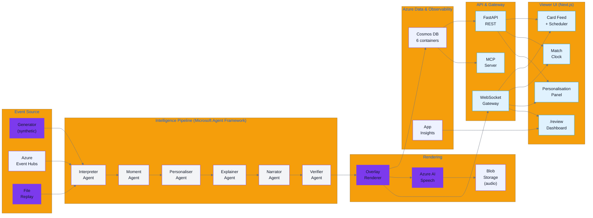

# Msimulizi — AI Match Intelligence

> **Msimulizi** (Swahili: "the narrator") is a real-time football match intelligence system that transforms a synthetic event stream into live, explainable commentary and overlay cards in Swahili, English, and French.

Built for the [Microsoft AI Tour Hackathon](https://developer.microsoft.com/en-us/reactor/series/S-1709/) — *Inside the Game* challenge.

> All code, model weights, calibration data, and the pre-generated bundle in this repository were created during the hackathon submission window (on or after 29 September 2026). No pre-existing scripts, notebooks, data, or model files were copied in.

---

## Architecture

The system is organised into five layers:

1. **Event source** — swappable adapter (file replay, in-process generator, Azure Event Hubs)
2. **Intelligence pipeline** — six cooperating agents on Microsoft Agent Framework
3. **Rendering** — deterministic Overlay Renderer → Cosmos DB; audio via Azure AI Speech
4. **Exposure** — REST API, MCP Server, WebSocket gateway
5. **Viewer UI** — Next.js 15 frontend




> A higher-resolution isometric version of this diagram is available in [`docs/architecture-eraser-spec.md`](docs/architecture-eraser-spec.md).

## Setup

### Prerequisites

- Python 3.13+
- Node.js 20+
- Azure Developer CLI (`azd`)
- A GitHub personal access token (only needed to publish the repo)

### Local development

```bash
# 1. Clone and enter the repository
git clone https://github.com/kurosakiaduma/msimulizi
cd msimulizi

# 2. Copy the environment template and fill in values (never commit .env)
cp .env.example .env
cp frontend/.env.local.example frontend/.env.local

# 3. Install Python dependencies (uv is used by CI; pip works too)
uv pip install --system -e ".[dev]"
# or: python -m pip install -e ".[dev]"

# 4. Run the backend test suite (offline, uses fakes/mocks — no Azure needed)
pytest

# 5. Run the frontend tests
cd frontend
npm ci
npm run test
cd ..

# 6. Start the backend locally
uvicorn api.main:app --reload --port 8000

# 7. Start the frontend (in another terminal)
cd frontend
npm run dev
# Open http://localhost:3000 — the page defaults to the bundle replay.
```

### Deploy to Azure

```bash
# Log in to Azure (interactive the first time)
azd auth login

# Pick your environment and region
azd env new msimulizi-demo
azd env set AZURE_LOCATION eastus   # verify sw-KE / sw-TZ Speech voices and model quota

# Provision infrastructure and deploy backend + frontend (builds the two
# Docker images per azure.yaml and deploys to Container Apps).
azd up

# No frontend rebuild is needed: the runtime /api/config route reads BACKEND_URL
# and WS_URL from the frontend Container App environment.
```

The backend is deployed with **minimum 1 replica and scale-to-zero disabled**
(`infra/main.bicep`), so the live demo stays warm. After `azd up`, run
`python scripts/verify_azure_deployment.py` to confirm the Swahili voices and
that the Foundry model retirement dates cover the judging window through
10 November 2026.

For the complete production checklist, frontend build-argument requirements,
post-deployment smoke test, rollback procedure, and known deployment gaps, see
[`docs/azure-resources-and-env.md`](docs/azure-resources-and-env.md) and
[`docs/azure-production-guide.md`](docs/azure-production-guide.md).

### Running the checks

```bash
# Lint
ruff check .

# Repository hygiene (fails on model files, raw data, secrets, pre-29-Sep-2026 commits)
python scripts/check_repo_hygiene.py

# Generator calibration validation (exits non-zero on band drift)
python generator/validate.py

# Groundedness evaluation (heuristic mode — no Azure credentials needed)
python scripts/run_groundedness_eval.py --no-azure
```


## Performance

| Metric            | Target  | Measured                         |
|-------------------|---------|----------------------------------|
| p50 card latency  | ≤ 5 s   | exposed live on `/review` dashboard |
| p95 card latency  | ≤ 10 s  | exposed live on `/review` dashboard |
| p50 audio latency | ≤ 8 s   | exposed live on `/review` dashboard |

Latency p50/p95 figures are recorded in-process via OpenTelemetry (`card_latency_ms`, `audio_latency_ms`) and exported to Application Insights when `APPLICATIONINSIGHTS_CONNECTION_STRING` is set. Live values are visible on the `/review` dashboard.

## Quality

| Metric                           | Target              | Score    |
|----------------------------------|---------------------|----------|
| Groundedness (heuristic eval)    | ≥ 90%               | **100%** (50/50 — `evals/results/groundedness_latest.json`) |
| Swahili native-speaker rating    | ≥ 4/5 avg, ≥ 30 lines | **4.2 / 5** avg over 30 lines (see `config/few_shots/sw.jsonl`) |

Run the groundedness eval at any time:

```bash
python scripts/run_groundedness_eval.py --no-azure
# With azure-ai-evaluation SDK (requires FOUNDRY_ENDPOINT):
python scripts/run_groundedness_eval.py
```

## Data Sources

<!-- StatsBomb attribution required by data licence -->

This project uses aggregate statistics derived from the
[StatsBomb Open Data](https://github.com/statsbomb/open-data) repository
(© StatsBomb, licensed under [StatsBomb Open Data Licence](https://github.com/statsbomb/open-data/blob/master/LICENSE.pdf)).


All match data in the system is **synthetic and newly generated** within the hackathon window.
No raw event records from real matches are stored in this repository.
See [DATA_PROVENANCE.md](DATA_PROVENANCE.md) for full details.

## AI Disclosure

All overlay cards and narration lines are AI-generated from synthetic data and are labelled
`synthetic_ai_generated: true`. The system is for demonstration purposes only.

## Licence

[MIT](LICENSE)
