# Msimulizi — Architecture and Runtime Diagrams

This is the current component map for the demo as it runs on 27 October 2026.
It covers the Azure infrastructure, the backend pipeline, the Next.js viewer,
the data model, and the observability/review loop.

The diagrams are intentionally explicit about the demo's constraints:

- Synthetic data only; no real clubs, players, or third-party marks.
- The backend runs at **one replica** (`minReplicas: 1`, `maxReplicas: 1`)
  because active sessions, WebSockets, caches, and the pub/sub bus are
  process-local.
- Captions are the primary surface. Audio is rendered after the caption and is
  fail-open: a rewrite, TTS, or storage failure never removes the caption.
- The native-speaker review queue is real work, not a quality claim. The
  current queue is **0/56 signed off**, so no average is publishable.
- CI is read-only with respect to Azure. Deployments are explicit operator
  actions with `azd deploy backend` / `azd deploy frontend`.

For the vocabulary, see [`glossary.md`](glossary.md). For the demo sequence,
see [`demo-guide.md`](demo-guide.md). For the complete Eraser.io diagram schema,
see [`architecture-eraser-schema.md`](architecture-eraser-schema.md); the smaller
pitch-deck block is in [`architecture-eraser-spec.md`](architecture-eraser-spec.md).

---

## 1. System context

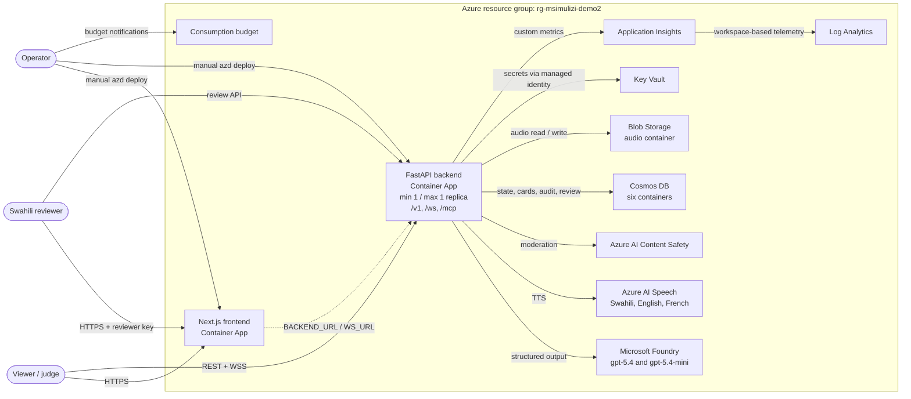

The public demo is available through **10 November 2026**. The frontend and
backend are separate Container Apps, but the browser talks to the backend
directly for REST and WebSocket traffic. The frontend's `/api/config` route
supplies the runtime backend and WebSocket URLs so one frontend image works
across environments.

---

## 2. Container and runtime view

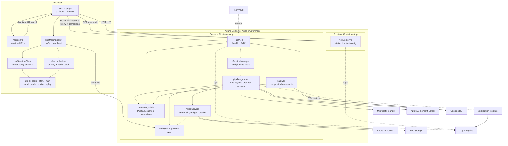

The frontend does not proxy match traffic. It serves the UI and runtime
configuration; the browser connects to the backend's public `/v1` and `/ws`
ingress. The MCP surface is mounted inside the backend process at `/mcp/`, so
it shares the same Cosmos repositories, pub/sub bus, and process lifecycle.

MCP authentication is required in production: the client sends a bearer token,
and an unauthenticated request to `/mcp/` returns `401`. The key is stored in
Key Vault and injected as a Container App secret; it is never committed.

### Why the backend is pinned to one replica

`SessionManager`, `WebSocketManager`, `PubSub`, narration caches, and the
in-flight audio map are in-memory. A second replica would not see the first
replica's sessions, WebSocket connections, or live state. The current
`minReplicas: 1` / `maxReplicas: 1` setting is therefore a correctness
constraint, not a cost optimum. Scaling wider requires a shared session and
WebSocket backplane first.

---

## 3. Backend pipeline and fallback paths

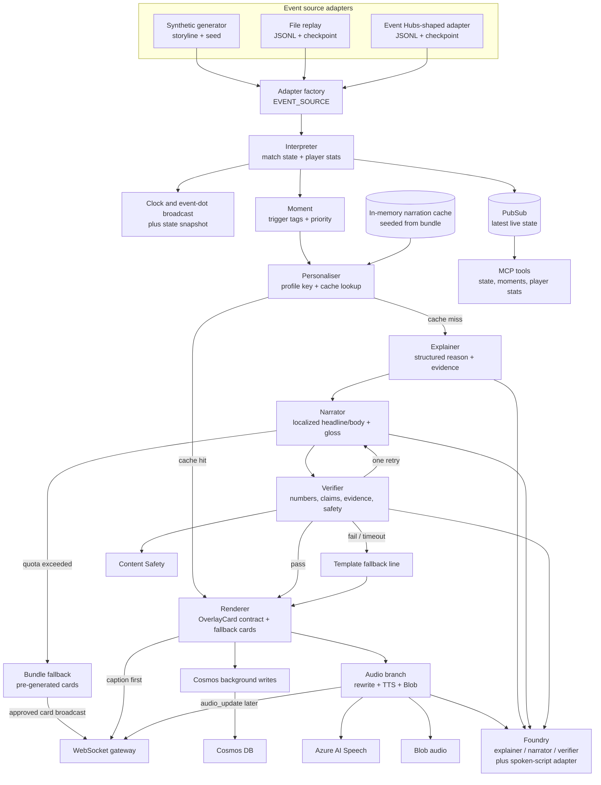

The runtime path is explicit in `api/pipeline_runner.py`; it is not an opaque
agent graph. `pipeline/orchestrator.py` exposes the Agent Framework-compatible
session/workflow facade, while the live driver owns the per-session event loop.
This keeps the stage order, failure branches, and timing visible and testable.

### Caption and audio ordering

The renderer broadcasts the approved caption first. The audio branch is a
separate asyncio task so a slow model or Speech call never delays the card.
The approved caption is never rewritten by the audio path.

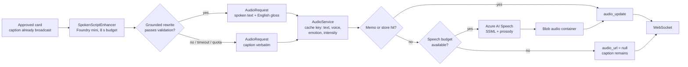

`AUDIO_SCRIPT_ENHANCE=true` enables the optional rewrite. Setting it to
`false` synthesizes the approved caption verbatim. A rewrite is exposed on
`audio_update` as `spoken_text` plus `spoken_gloss_en` only when it differs
from `source_text`; the card stays unchanged.

### Fallback summary

| Failure | Fallback | Caption still delivered? |
|---|---|---|
| Foundry timeout or 429 | Bundle card, then deterministic template line | Yes |
| Verifier rejection | One Narrator retry, then template fallback | Yes |
| Content Safety block | Fallback line or drop stat/spotlight card | Yes for key moments |
| Cosmos unavailable | In-memory stores plus write buffer | Yes |
| Speech timeout, budget, or breaker open | `audio_url: null` | Yes |
| Spoken rewrite invalid | Synthesize the approved caption verbatim | Yes |
| Out-of-order clock anchors | Frontend clamps to the newest forward anchor | Yes |

---

## 4. Frontend component and data flow

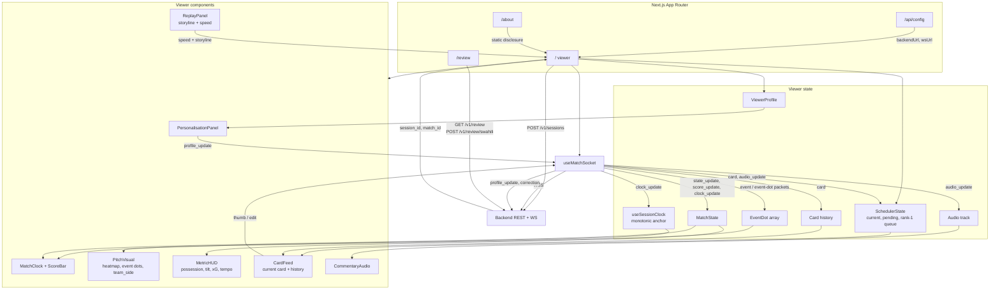

Key client-side rules:

- The clock is re-anchored to each authoritative card or event time and never
  moves backwards. `useSessionClock` takes the maximum of the incoming anchor
  and the visible clock while running.
- The scheduler shows one card at a time. Priority 1 cards are queued rather
  than dropped; lower-priority cards can be pre-empted or discarded once stale.
- `audio_update` patches both the card history and the scheduler copy, so the
  audio-only mode and the visual feed stay consistent.
- The reviewer page uses the reviewer key for `/v1/review` and
  `/v1/review/swahili`; it is a separate surface from the viewer.

---

## 5. Persistence and data model

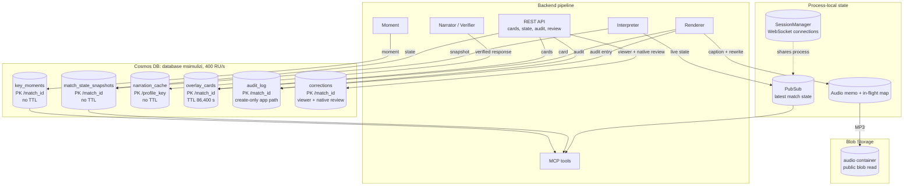

The six containers are:

| Container | Partition key | TTL | Main writer / reader |
|---|---|---|---|
| `match_state_snapshots` | `/match_id` | none | Pipeline writes; MCP and REST read |
| `key_moments` | `/match_id` | none | Pipeline writes; MCP reads |
| `narration_cache` | `/profile_key` | none | Verifier-approved responses |
| `overlay_cards` | `/match_id` | 86,400 s | Renderer writes; REST reads |
| `audit_log` | `/match_id` | none | Renderer/verifier audit entries |
| `corrections` | `/match_id` | none | Viewer feedback and native review |

Cosmos is the durable store; the backend still keeps in-memory mirrors for
live state, bundle narration, reviewer corrections, and audio memoization. A
Cosmos write failure does not stop a caption: the repositories buffer writes,
and the in-memory mirror keeps the current session usable.

The **audio blob container** is public-read at the blob level so the browser
can play the MP3 directly. Writes use managed identity and the Storage Blob
Data Contributor role. There is no CDN or Front Door in the current stack.

---

## 6. Azure infrastructure topology

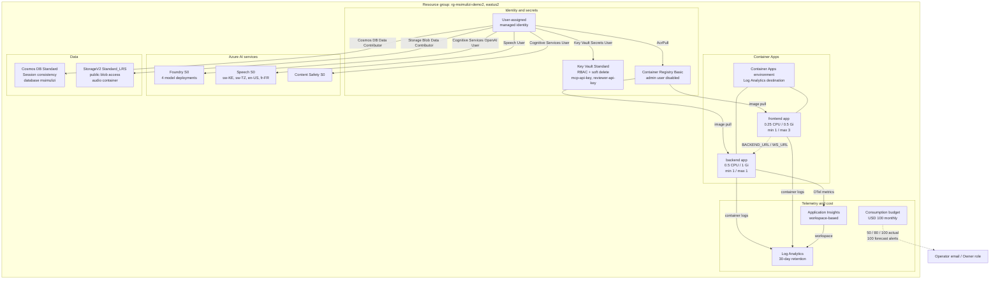

### Deployments and service choices

| Component | Current choice |
|---|---|
| Foundry | `gpt-5.4` for Swahili narration; `gpt-5.4-mini` for Explainer, Verifier, English/French narration, and spoken-script rewrites |
| Foundry deployments | `msimulizi-explainer`, `msimulizi-narrator-sw`, `msimulizi-narrator-en-fr`, `msimulizi-verifier` |
| Search / vector store | Not used; retrieval is deterministic event/state evidence |
| Speech | Azure AI Speech REST + SSML; Swahili voices `sw-KE-ZuriNeural`, `sw-TZ-RehemaNeural`, plus English and French |
| Event source | `EVENT_SOURCE=inprocess` by default; file replay and Event Hubs-shaped checkpoint adapters exist |
| Persistence | Cosmos DB, six containers; Blob Storage for audio |
| Secrets | Key Vault + user-assigned managed identity; live deployments use `KEY_MODE=preserve` |
| Hosting | Two Container Apps in one environment; backend one replica, frontend 1–3 |
| Budget | Separate `infra/budget.bicep` deployment; alerts at 50%, 80%, 100% actual and 100% forecast |

No virtual network, private endpoint, Front Door, CDN, Event Hubs namespace, or
App Insights alert rule is provisioned by `infra/main.bicep`. Those are
deliberate demo-scope choices, not claims of production hardening. The budget
is a guardrail, not a hard spend cap.

---

## 7. Observability and the review loop

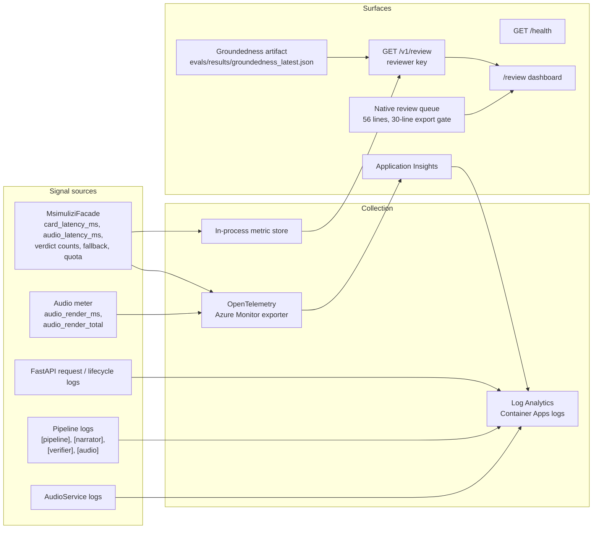

### Instrumented metrics

| Metric | Type | Recorded by | Notes |
|---|---|---|---|
| `card_latency_ms` | histogram | `api/pipeline_runner.py` | Event receipt to card delivery; labels `language`, `card_type` |
| `audio_latency_ms` | histogram | `api/pipeline_runner.py` | Time around the audio task; audio is intentionally after the caption |
| `verdict_pass_count` | counter | Verifier | Emitted on a passing verdict |
| `verdict_fail_count` | counter | Verifier | Emitted on a failed verdict |
| `fallback_count` | counter | Verifier | Template fallback path |
| `quota_exceeded_count` | counter | Pipeline / audio | Model or Speech quota refusal |
| `audio_render_ms` | histogram | `renderer/audio/metrics.py` | Audio service render time by outcome, language, emotion |
| `audio_render_total` | counter | `renderer/audio/metrics.py` | Render outcomes, including cache hits and breaker opens |

`/v1/review` also exposes the in-process p50/p95 snapshot, verdict counts,
fallback/quota counts, the latest groundedness score, viewer corrections, and
the Swahili review queue. The in-process store is always written, so the
dashboard works without App Insights credentials.

### Current observability limits

- The review metrics are **process-local**. With one backend replica they are
  the process's current numbers; with more replicas each process would have its
  own snapshot. A shared metric backend would be needed before scaling.
- Custom OpenTelemetry **metrics** are instrumented. There is no custom
  distributed-tracing span instrumentation in the current code.
- Log Analytics receives Container Apps logs with 30-day retention. Application
  Insights is workspace-based.
- Budget notifications are the only codified alert path. No Application
  Insights alert rules are defined in Bicep.
- The groundedness artifact is a 50-entry heuristic pass at **1.0**. It is not a
  native-language quality score and must not be presented as one.
- The native review queue is **0/56**. The export gate refuses to publish an
  average before 30 distinct signed-off lines.

### Native review flow

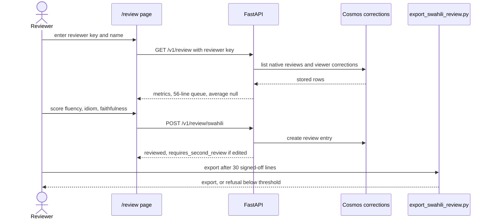

A submitted line is marked reviewed, not automatically approved. Edited lines
require an independent second review before they can leave the export gate.

---

## 8. Live replay sequence

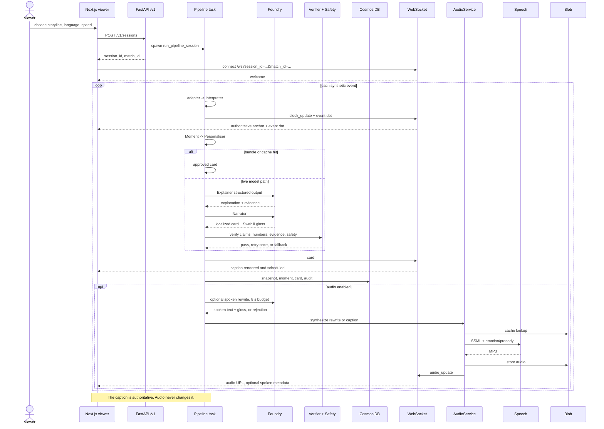

If the audio rewrite is rejected, missing, or slow, the approved caption is
synthesized instead. If Speech is unavailable or over budget, the card remains
visible with `audio_url: null`.

---

## 9. Build, CI, and deployment

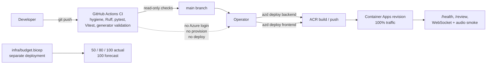

CI does **not** create or modify Azure resources. It runs repository hygiene,
Ruff, backend tests, frontend tests, and generator validation. Deployment is an
explicit operator action: `azd deploy backend` or `azd deploy frontend`, then a
revision check and smoke test.

---

## 10. Current constraints and follow-ups

| Area | Current constraint | Follow-up |
|---|---|---|
| Backend scale | One replica because sessions and WebSockets are process-local | Add a shared session/WebSocket backplane before increasing replica count |
| Observability | `/v1/review` reads an in-process metric snapshot | Export/query a shared metric store if replicas increase |
| Tracing | Custom OTel metrics; no custom span instrumentation | Add request/event spans if deeper latency analysis is needed |
| Alerting | Budget alerts are codified | Add Application Insights alert rules for errors, latency, and dependency failures |
| Audit RBAC | `audit_log` is written through a create-only repository path; the Bicep custom role definition is not bound to the app identity | Decide whether to split identities/roles or document Data Contributor as the live scope |
| Network | Public Container Apps ingress; no VNet/private endpoints | Add private networking if the demo becomes a production service |
| Audio delivery | Public-read Blob container | Add CDN/Front Door and private origin if needed |
| Domain / CORS | Generated `*.azurecontainerapps.io` hostnames | Update custom domain and exact CORS origins before any public rebrand |
| Native review | 0/56 signed off; no published average | Complete the human review and export gate |
| Load testing | Not yet run for WebSockets, Speech, Foundry, Cosmos, or Blob egress | Load-test before increasing traffic or replicas |
| Event Hubs | Adapter shape exists; no Event Hubs namespace is provisioned | Provision and authenticate a live namespace if needed |

---

## 11. Source map

| Area | Files |
|---|---|
| App assembly, routes, WebSocket, pipeline driver | `api/main.py`, `api/routes.py`, `api/websocket.py`, `api/pipeline_runner.py` |
| Pipeline stages | `pipeline/interpreter.py`, `pipeline/moment.py`, `pipeline/personaliser.py`, `pipeline/explainer.py`, `pipeline/narrator.py`, `pipeline/verifier.py`, `pipeline/orchestrator.py` |
| Cards, fallback, audio | `renderer/renderer.py`, `renderer/fallback.py`, `renderer/audio/` |
| Shared services | `shared/cosmos.py`, `shared/foundry_client.py`, `shared/content_safety.py`, `shared/pubsub.py`, `shared/observability.py`, `shared/budget.py` |
| MCP | `mcp_server/server.py` |
| Event sources and generator | `adapter/`, `generator/` |
| Frontend | `frontend/src/app/`, `frontend/src/components/`, `frontend/src/hooks/`, `frontend/src/lib/` |
| Infrastructure | `infra/main.bicep`, `infra/budget.bicep`, `azure.yaml`, `Dockerfile.backend`, `frontend/Dockerfile` |
| CI and checks | `.github/workflows/ci.yml`, `scripts/check_repo_hygiene.py`, `scripts/run_groundedness_eval.py` |
| Review workflow | `docs/native-speaker-review.md`, `scripts/export_swahili_review.py`, `/review` |
